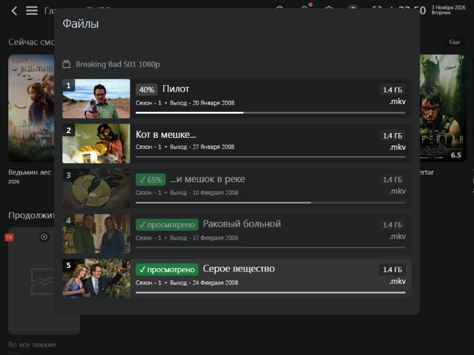
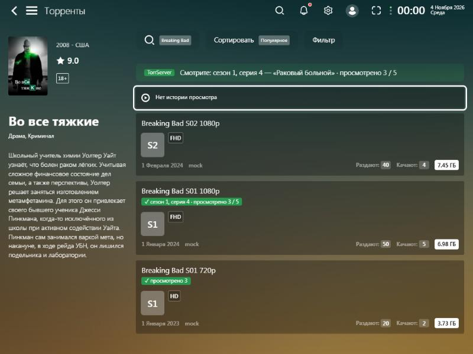
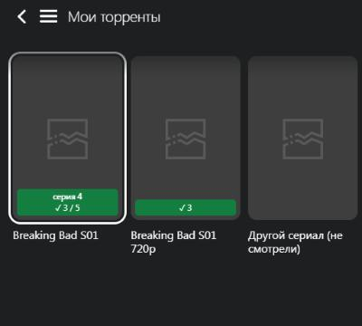

# TorrServer Viewed — плагин для Lampa

Показывает просмотренные серии в списке файлов торрента, который Lampa открывает через встроенный клиент TorrServer. Отметки берутся из самого TorrServer (`/viewed`), поэтому совпадают с веб-интерфейсом TorrServer, TS AutoUpdater и другими клиентами.



## Что делает

- При открытии списка файлов запрашивает у TorrServer `{"action":"list","hash":...}` и помечает просмотренные файлы зелёным значком «✓ просмотрено» и приглушает их.
- Если в Lampa есть прогресс просмотра (timeline), показывает его: `40%` для начатой серии и `✓ 65%` для отмеченной, но не досмотренной. Под каждой серией остаётся обычная полоска прогресса Lampa.
- Когда серия запускается из Lampa (из списка, кнопкой «следующая серия» в плеере или во внешнем плеере), плагин ставит её просмотренной в TorrServer: `{"action":"set",...}`.
- В меню долгого нажатия на файл добавлен пункт «TorrServer: отметить просмотренной» или «TorrServer: снять отметку просмотра» (`"rem"`).
- Штатные пункты Lampa из того же меню тоже синхронизируются: «Просмотрено» ставит отметку в TorrServer, «Сбросить тайм-код» снимает её.
- На экране «Торренты» карточки (кнопка «Торренты») вверху появляется строка «Смотрите: сезон 1, серия 4 — «…» · просмотрено 3 / 5». У раздач, которые уже есть в TorrServer, стоит значок с текущей серией и числом просмотренных.

  

  Как это работает: TorrServer хранит только номера просмотренных файлов. Поэтому плагин сам запоминает в Lampa, какая серия лежит в каком файле, когда вы открываете список файлов, и какую серию запускали последней. Раздача на экране «Торренты» сопоставляется с торрентом в TorrServer двумя способами: по хешу из magnet-ссылки или по номеру карточки, который Lampa записывает в торрент при добавлении. Если список файлов раздачи в Lampa ещё не открывали (например, её добавили через TorrServerAdder и смотрели в другом клиенте), будет видно только число просмотренных файлов, без номера серии. Раздачу, найденную только по ссылке на `.torrent`-файл без magnet, плагин сопоставить не может. Эта строка отключается в настройках.
- На экране «Мои торренты» на постере каждой раздачи появляется плашка: текущая серия («серия 4», для второго и следующих сезонов ещё и «сезон 2») и число просмотренных («✓ 3 / 5»). Если список файлов раздачи в Lampa ещё не открывали, будет видно только «✓ 3». После возврата из списка файлов плашки обновляются.

  
- Адрес TorrServer, логин и пароль берутся из настроек Lampa (Настройки → TorrServer). Запросы идут через сетевой модуль Lampa, и он сам добавляет Basic-авторизацию.
- В Настройки → TorrServer добавлены четыре переключателя, все по умолчанию включены:
  - «Отмечать серию при запуске»;
  - «Текущая серия в списке торрентов» (экран «Торренты» карточки);
  - «Серии на карточках «Мои торренты»» (плашки убираются и появляются сразу, без перезапуска);
  - «Приглушать просмотренные».

## Требования

- TorrServer MatriX (проверено с API `/viewed` версии 1.2.x).
- В Lampa на Android включён параметр **Настройки → TorrServer → «Встроенный клиент»**. Без него Lampa отдаёт торрент внешнему приложению и не показывает свой список файлов.
- Настройка Lampa «Включить TrackTimecode» не нужна, плагин работает и с ней, и без неё. TrackTimecode рассчитан на форки TorrServer с сохранением тайм-кода, а MatriX поле `timecode` просто игнорирует.

## Как подключить в Lampa

1. Настройки → **Расширения** → **Добавить плагин**.
2. Введите адрес:

   ```
   https://nikandrei.github.io/lampa-torrent-viewed/viewed.js
   ```

3. Перезапустите Lampa.
4. Откройте сериал → Торренты → выберите раздачу. В списке файлов появятся отметки.

Запасной адрес через jsDelivr:
`https://cdn.jsdelivr.net/gh/NikAndrei/lampa-torrent-viewed@main/viewed.js`

## Обновление

Адрес `nikandrei.github.io` раздаёт GitHub Pages из ветки `gh-pages`. После изменений в `main` её нужно обновить:

```bash
git push origin main main:gh-pages
```

Через минуту-две новая версия будет на сайте. Перезапустите Lampa, чтобы она её загрузила.

jsDelivr берёт файл из `main` и держит старую версию до 12 часов. Чтобы сбросить её сразу, откройте https://purge.jsdelivr.net/gh/NikAndrei/lampa-torrent-viewed@main/viewed.js.

Ссылка вида `raw.githubusercontent.com/...` **не подойдёт**: GitHub отдаёт её как `text/plain` с заголовком `nosniff`, и браузер не запускает такой скрипт.

Для проверки правок до коммита файл можно раздать с компьютера в домашней сети:

```bash
python -m http.server 8000
```

Ссылка: `http://<IP_компьютера>:8000/viewed.js`. Так работает только приложение Lampa для Android или Lampa, открытая по `http://`.

## Проверка

Плагин проверен на веб-версии Lampa 3.4.4 (из https://github.com/yumata/lampa), запущенной локально, с имитацией TorrServer из `test/mock_torrserver.py`. Это небольшой сервер на Python с `/settings`, `/torrents`, `/viewed` и `/stream`. Проверено:

- плагин загружается из списка расширений и не ломает Lampa;
- серии, отмеченные в TorrServer, показываются со значком и приглушены;
- запуск серии и переход к следующей серии в плеере отправляют `set` с нужным `file_index`;
- пункты меню долгого нажатия отправляют `set` и `rem`, штатные «Просмотрено» и «Сбросить тайм-код» синхронизируются;
- Basic-авторизация из настроек Lampa подставляется в запросы;
- на карточках «Мои торренты» видны плашки, а переключатель в настройках убирает и возвращает их;
- на экране «Торренты» видна текущая серия, а раздачи находятся по hex- и base32-magnet и по номеру карточки. Для этого имитация отвечает и как Jackett: адрес парсера `http://127.0.0.1:8091`, ключ любой.

На настоящем TorrServer и приставке плагин не проверялся.

Как повторить проверку:

```bash
python test/mock_torrserver.py 8091
```

Затем в Lampa укажите адрес TorrServer `http://127.0.0.1:8091` и откройте в консоли браузера:

```js
Lampa.Torrent.open('aaaabbbbccccddddeeeeffff0000111122223333', {id:1396, name:'Во все тяжкие', original_name:'Breaking Bad', source:'tmdb'})
```

Текущее состояние отметок в имитации можно посмотреть на `http://127.0.0.1:8091/mocklog`.

## Как устроено

Плагин использует события, которые Lampa отправляет при работе со списком файлов (`Lampa.Listener` → `torrent_file`: `list_open`, `render`, `onenter`, `onlong`, `list_close`). На экране «Торренты» он слушает событие `torrent` → `render`, а соответствие файлов и серий хранит в `Lampa.Storage` под ключом `tsv_watch` (по хешу торрента). Карточки «Моих торрентов» плагин находит, когда они появляются на странице: Lampa кладёт данные раздачи в `card_data` элемента `.card`. Ещё он слушает начало воспроизведения (`Lampa.Player.listener` → `start`, `external`) и изменения прогресса (`Lampa.Timeline.listener` → `update`). Код Lampa плагин не меняет.
